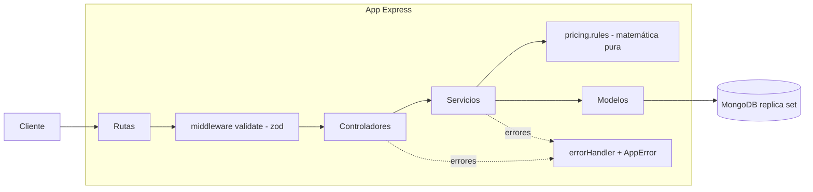
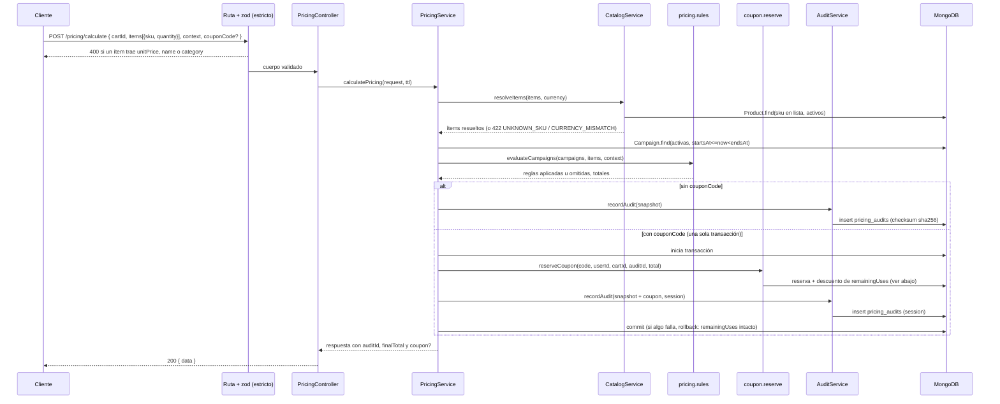
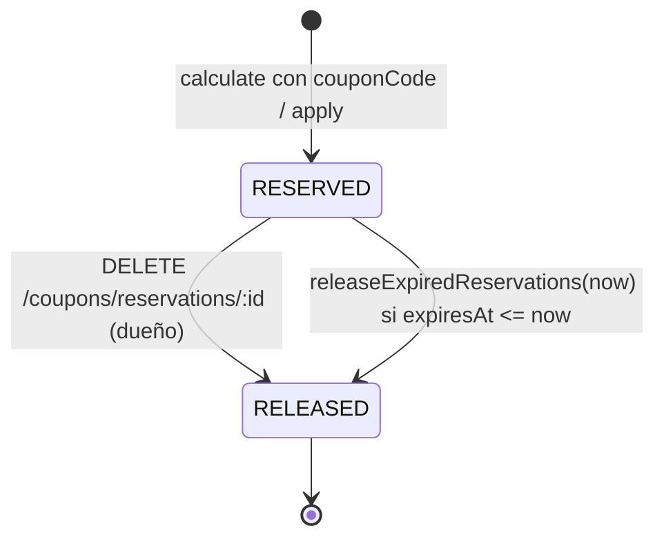
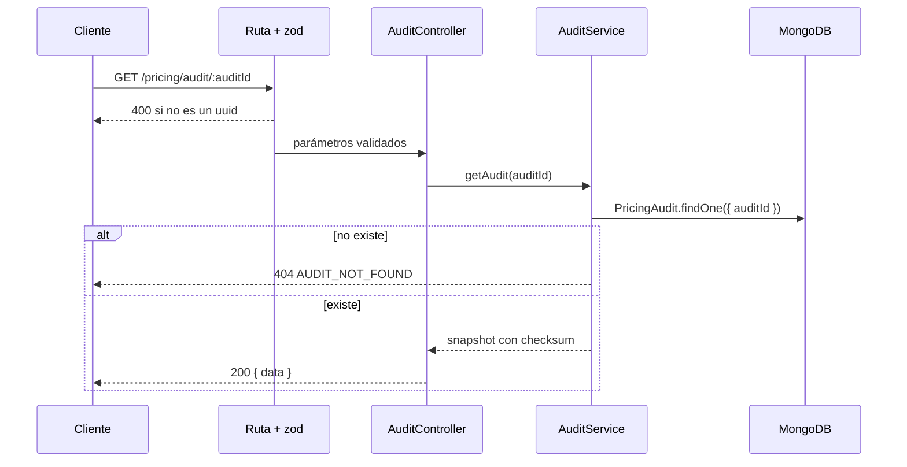
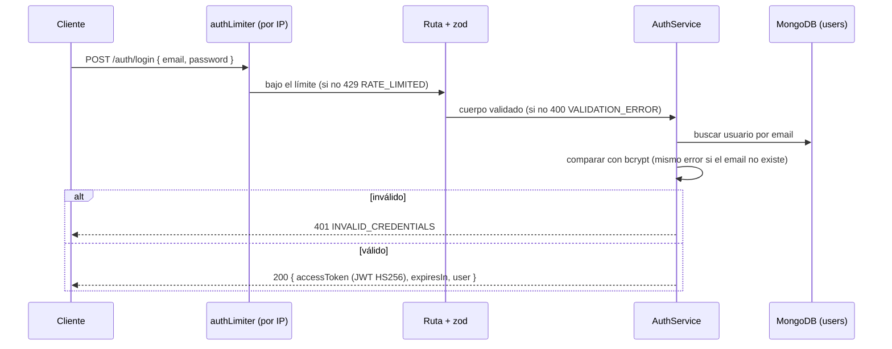
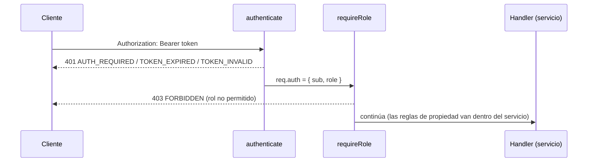
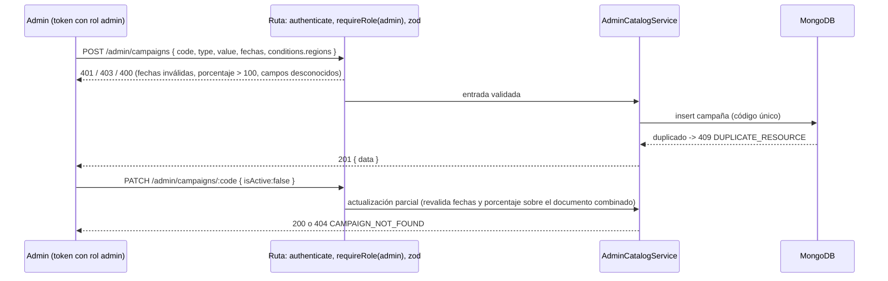
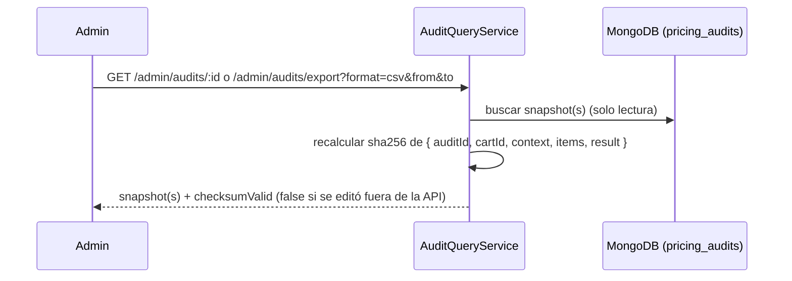

# Arquitectura

## Capas



Flujo de una solicitud: Cliente -> Ruta -> Controlador -> Servicio -> Modelo -> MongoDB -> Respuesta.

- `public/` (interfaz en JavaScript vanilla) la sirve Express como archivos estáticos
  (`express.static`) después de Helmet, en el mismo origen que la API.
- Las rutas conectan los paths con la validación de zod y los controladores.
- Los controladores solo manejan HTTP: nunca importan modelos y no tienen lógica de dominio.
- Los servicios contienen la orquestación y la lógica de dominio y nunca importan express.
- `pricing.rules.ts` es matemática pura y determinista (sin I/O); `now` se puede inyectar.
- Los modelos son esquemas de Mongoose; `pricing_audits` es inmutable mediante hooks del esquema.
- El manejador global de errores convierte `ZodError`, `AppError`, JSON inválido y llaves duplicadas
  al formato `{ error: { code, message, details? } }`.

## Secuencia: POST /api/v1/pricing/calculate



## Secuencia: POST /api/v1/coupons/apply (transacción)

```mermaid
sequenceDiagram
  participant C as Cliente
  participant K as CouponController
  participant S as CouponService
  participant V as coupon.reserve
  participant DB as MongoDB
  C->>K: POST /coupons/apply { code, auditId } (validado, estricto)
  K->>S: applyCoupon(request, token.sub, ttl)
  S->>DB: PricingAudit.findOne({ auditId, context.userId = sub })
  alt no existe o es ajena
    S-->>K: 404 AUDIT_NOT_FOUND
  end
  S->>DB: inicia transacción (connection.transaction)
  S->>V: reserveCoupon(subtotal = audit.result.total, cartId = audit.cartId)
  V->>DB: findOne cupón (404 si no existe o es de otro usuario)
  V->>V: inactivo o vencido -> 409 COUPON_UNAVAILABLE; subtotal < minSubtotal -> 422
  V->>DB: libera reservas vencidas de ese carrito; existe RESERVED en el carrito/auditoría (cualquier código) -> 409 COUPON_ALREADY_APPLIED
  V->>DB: findOneAndUpdate remainingUses>0, $inc -1 (409 COUPON_EXHAUSTED)
  V->>DB: count reservas RESERVED vigentes del usuario >= perUserLimit -> 409 COUPON_LIMIT_REACHED
  V->>DB: insert CouponReservation { status RESERVED, expiresAt }
  S->>DB: commit
  S-->>C: 201 { data }
```

El decremento del cupón va antes del conteo por usuario a propósito: dos transacciones simultáneas
escriben el mismo documento de cupón, una falla con un conflicto de escritura transitorio y se
reintenta, de modo que la segunda ya ve la reserva confirmada de la primera. Así `perUserLimit` se
cumple sin carreras, `remainingUses` nunca baja de cero y las reservas nunca superan `maxUses`. Un
rechazo posterior al decremento aborta la transacción y revierte el uso.

## Ciclo de vida de la reserva

Un solo cupón activo por auditoría y por carrito/usuario: índices únicos parciales (`status: RESERVED`)
sobre `{auditId}` y `{cartId, userId}` más una comprobación dentro de la transacción; el duplicado da 409
`COUPON_ALREADY_APPLIED`. El cupón lleva `currency` y se rechaza con 422 `CURRENCY_MISMATCH` si difiere
de la auditoría; `/coupons/apply` rechaza auditorías más viejas que `AUDIT_QUOTE_TTL_SECONDS` (409
`AUDIT_STALE`). El bloque `coupon` de una auditoría es válido solo mientras su reserva esté activa: la
auditoría es inmutable y no refleja la liberación o el vencimiento de la reserva.



La transición es un `findOneAndUpdate` filtrado por `status: RESERVED` dentro de una transacción junto
con el `$inc: +1` del cupón (con tope en `maxUses`), así que cada reserva devuelve su uso exactamente
una vez aunque coincidan una liberación manual y la barrida. La barrida (`reservation.sweeper.ts`)
la arranca solo `server.ts` con un `setInterval` con `unref()`. El índice único `{couponCode, cartId}`
es parcial (`status: RESERVED`).

## Secuencia: GET /api/v1/pricing/audit/:auditId



## Inmutabilidad

Los paths de `pricing_audits` son `immutable: true`, el esquema es `strict: 'throw'` y los pre-hooks
de todo update, replace, delete, bulkWrite y de update, delete o re-guardado a nivel de documento
lanzan `AppError(409, AUDIT_IMMUTABLE)`. El checksum es el sha256 del JSON canónico (con llaves
ordenadas) de `{ auditId, cartId, context, items, result }`, más `coupon` solo cuando la auditoría se
calculó con un cupón (las auditorías anteriores, sin ese campo, siguen verificando). Los ítems guardados
son los resueltos desde el catálogo. (Las escrituras hechas fuera de
Mongoose, directamente sobre la base de datos, no se bloquean en esta capa, y el checksum sin llave
solo detecta ediciones accidentales o simples, no a quien lo recalcula; planeado: HMAC con un secreto
dedicado.)

## Seguridad

Orden de los middlewares en `createApp(config)`: se desactiva `x-powered-by`, parser de query simple,
`trust proxy` según la configuración, helmet, lista permitida de CORS, limitador de tasa global,
`express.json` (límite de 100kb), `rejectOperatorKeys`, rutas, `notFound`, `errorHandler`. Los
limitadores, CORS y el servicio de tokens se construyen por instancia de la app a partir de
`AppConfig`, así que las pruebas tienen almacenes de limitadores en memoria aislados. Por ruta:
`authenticate` (JWT Bearer, HS256 fijo, issuer y audience verificados), `requireRole`, el limitador
de cupones (por sujeto del token) y luego la validación de Zod. `rejectOperatorKeys` devuelve 400
`INVALID_INPUT` para cualquier llave de body, query o params que contenga `$` o `.` o sea igual a
`__proto__`, `constructor` o `prototype`; los tipos de Zod y `sanitizeFilter` de Mongoose lo
respaldan.

Regla de propiedad: el dueño de la auditoría es `context.userId`, que ya está cubierto por el
checksum. `resolvePricingOwner` lo fuerza al sujeto del token para los clientes (403 `USER_MISMATCH`
si el cuerpo nombra a otra persona) y deja que los admins calculen precios en nombre de un usuario.
`getAudit` filtra a los clientes por `context.userId`, así que la auditoría de otro usuario es
indistinguible de una inexistente (404). Las auditorías antiguas del E1 (`userId: user-1`) no
coinciden con ningún sujeto real, así que solo los admins pueden leerlas. El rol viene del token sin
consultar la base de datos en cada solicitud, así que un cambio de rol se aplica cuando el token
expira.

## Secuencia: POST /api/v1/auth/register y /login



El registro tiene la misma forma: el rol nunca se lee del cuerpo (400 si se envía), se guarda el hash
bcrypt y un email duplicado devuelve 409 `EMAIL_TAKEN`.

## Secuencia: solicitud protegida (toda ruta de /pricing, /coupons y /admin)



## Cupón ligado a un usuario

`coupon.userId` definido y distinto del sujeto del token da 404 `COUPON_NOT_FOUND`, igual que un código
desconocido (evalúa antes que el estado activo o vencido). Un cupón de un solo uso (`maxUses` 1) llega a
`remainingUses` 0 al reservarse; la reserva registra quién lo usó, en qué carrito y en qué auditoría.

## Secuencia: catálogo de administración (campañas, cupones y productos)



`/admin/products` sigue el mismo patrón (`AdminProductsService`: 409 `PRODUCT_EXISTS`, 404
`PRODUCT_NOT_FOUND`) y `GET /catalog` expone solo los productos activos. El cálculo de precios toma estas campañas en el siguiente `/pricing/calculate`, porque lee las
campañas activas por rango de fechas cada vez (nada se guarda en caché ni está escrito en el código).

### Administración de regiones

`PUT` / `DELETE /admin/campaigns/:code/regions/:region` usan actualizaciones atómicas únicas:
`$addToSet` y `$pull` filtrado para que solo coincida mientras la lista tenga más de un elemento. Un
fallo se resuelve con una lectura: campaña desconocida -> 404, región ausente -> 200 sin cambios, y en
otro caso 409 `LAST_REGION`. Por eso dos eliminaciones concurrentes de las dos últimas regiones no
pueden vaciar la lista. `GET /admin/regions` agrupa todas las campañas por región (solo lectura).

## Secuencia: respaldo de auditoría para el admin



## Pedidos, envío y nivel del cliente

- `pricing.price.ts` calcula un carrito solo con datos del servidor (catálogo y campañas) y lo reutilizan `calculate` y el recálculo del pedido; `pricing.response.ts` arma la respuesta (`lineTotal`, `savings`, `shippingOptions`, `nextThreshold`) y `config/shipping.ts` guarda las tarifas.
- El nivel del cliente se lee del documento `User` en cada solicitud (`user.tier.ts`); nunca viene del token ni del cuerpo.
- `POST /orders` (`order.service.ts`): busca la auditoría del usuario, exige envío y región coherente, recalcula (`order.reprice.ts`) y, en una sola transacción (`order.place.ts`), pasa la reserva de `RESERVED` a `CONSUMED` y crea el `Order` (instantánea inmutable, único por `auditId`). Una repetición devuelve el mismo pedido.
- El checksum de la auditoría incluye `shipping` solo cuando existe, igual que `coupon`, por lo que las auditorías anteriores siguen verificando.
- `models/reservationIndexes.ts` repara al arrancar el índice `couponCode_1_cartId_1` y libera duplicados `RESERVED` antes de reconstruir los índices.
