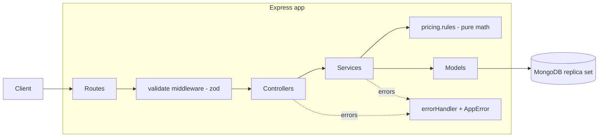
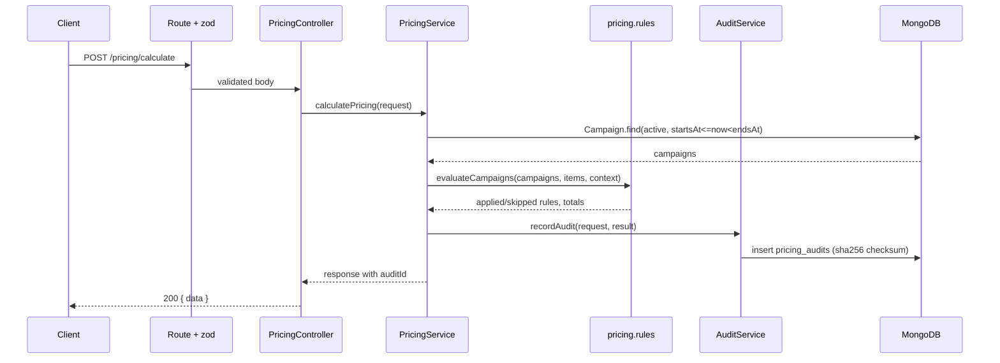
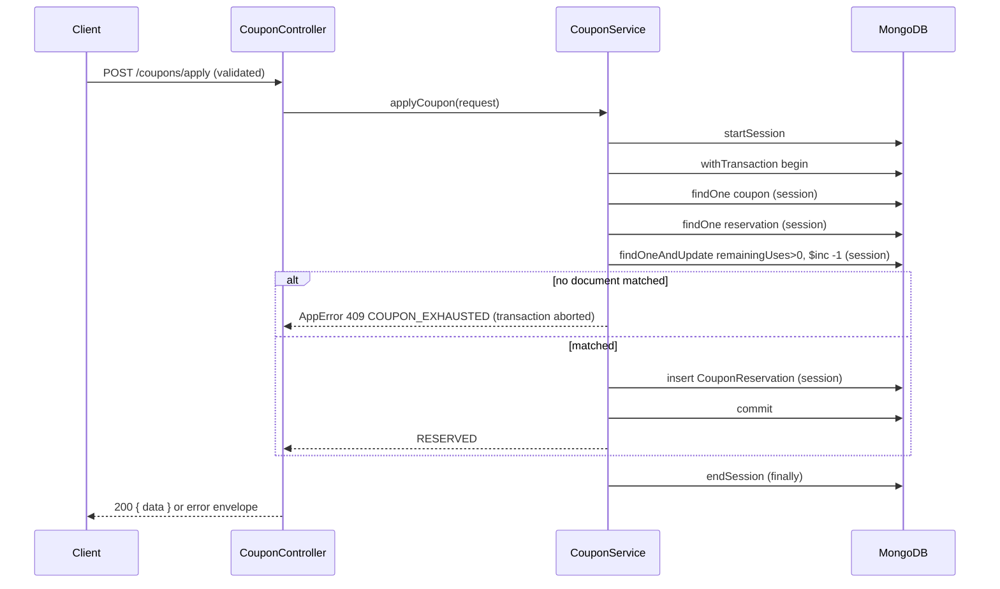
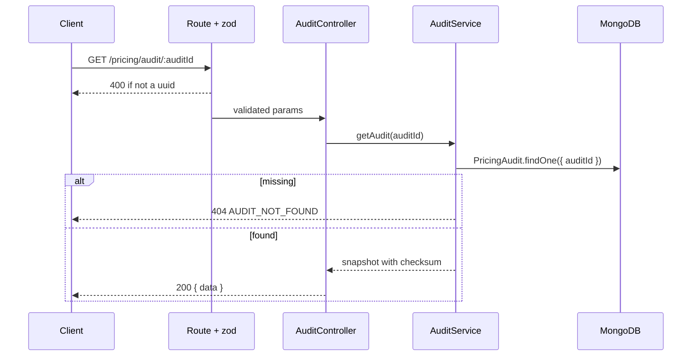

# Architecture

## Layers

Request flow: Client -> Route -> Controller -> Service -> Model -> MongoDB -> Response.

- Routes bind paths to zod validation and controllers.
- Controllers handle HTTP only: they never import models and hold no domain logic.
- Services hold orchestration and domain logic and never import express.
- `pricing.rules.ts` is pure, deterministic math (no I/O); `now` is injectable.
- Models are Mongoose schemas; `pricing_audits` is immutable via schema hooks.
- The global error handler maps `ZodError`, `AppError`, bad JSON and duplicate keys to the
  `{ error: { code, message, details? } }` envelope.

## Sequence: POST /api/v1/pricing/calculate

## Sequence: POST /api/v1/coupons/apply (transaction)

Write conflicts from concurrent transactions are transient errors that `withTransaction` retries,
so `remainingUses` can never go below zero and reservations never exceed `maxUses`.

## Sequence: GET /api/v1/pricing/audit/:auditId

## Immutability

`pricing_audits` paths are `immutable: true`, schema is `strict: 'throw'`, and pre-hooks on every
update, replace, delete, bulkWrite and document-level update/delete/re-save throw
`AppError(409, AUDIT_IMMUTABLE)`. The checksum is the sha256 of the canonical (sorted-key) JSON of
`{ auditId, cartId, context, items, result }`. (Writes made outside Mongoose, directly against the
database, are not blocked at this layer.)
